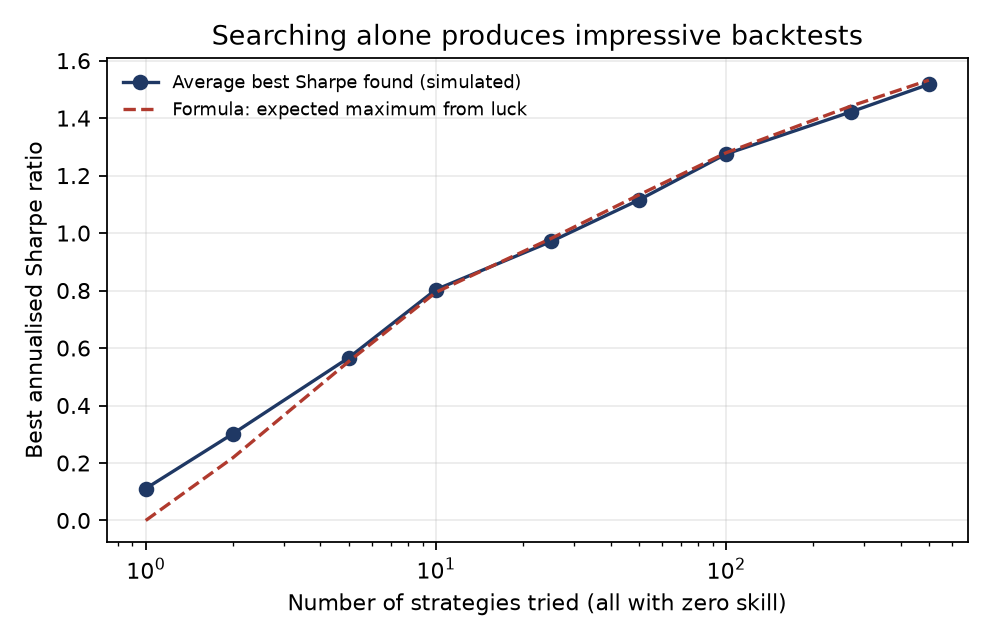
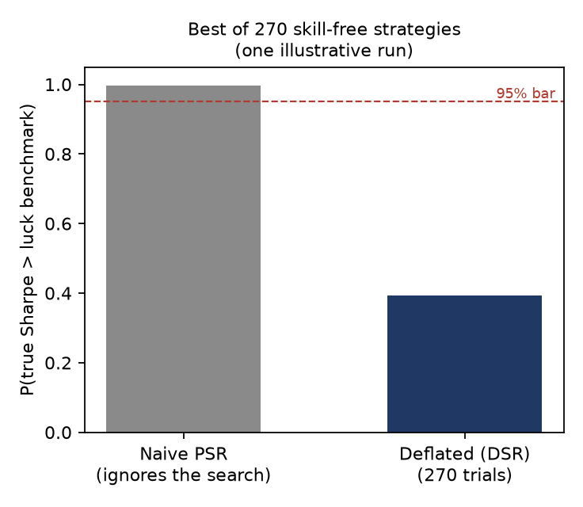
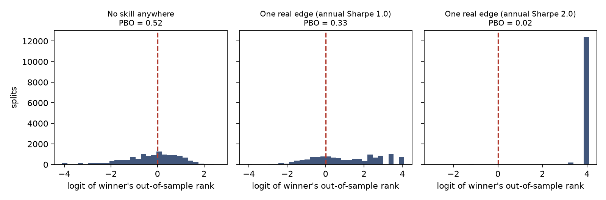
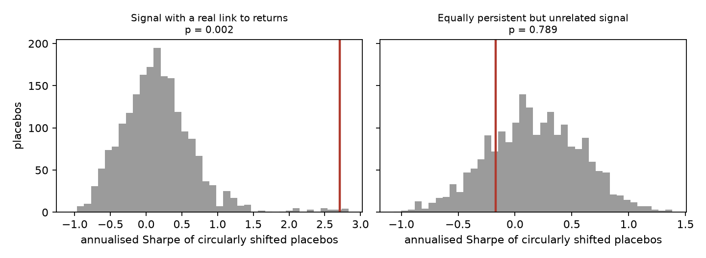
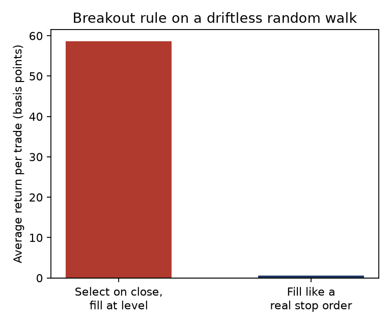

# backtest-overfitting-lab

Small, tested tools for answering one question: **is this backtest result real, or did I just search until something looked good?**

Search is the usual way strategies get fooled. Try enough ideas and one will look excellent by luck. This repository implements four standard defenses against that, shows each one working on synthetic data where the truth is known, repeats the experiments to measure how often they work, and reproduces every number below with one command.

> **Authorship.** The research design, the choice of tests and the validation decisions are mine. Implementation was AI-assisted (Claude). The tests check the code against hand-computed values, known statistical properties and repeated simulations, rather than trusting it.

## What is inside

| Tool | Question it answers | Source method |
|---|---|---|
| `deflated_sharpe` | After trying N strategies, is the best one's Sharpe ratio still better than what luck would produce? | Bailey and López de Prado (2012, 2014) |
| `cscv` (PBO) | How often does the in-sample winner land in the bottom half out-of-sample? | Bailey, Borwein, López de Prado, Zhu (2015) |
| `circular_shift_test` | Does a timing signal beat placebo signals with the same exposure and persistence? | Circular-shift permutation test |
| `breakout_biased` / `breakout_honest` | What does a look-ahead bug do to a result? | Worked example |

## Quick start

```bash
git clone https://github.com/kaicheng042008-sudo/backtest-overfitting-lab.git && cd backtest-overfitting-lab
python -m venv .venv && source .venv/bin/activate
pip install -e . pytest            # or: pip install -r requirements.txt and run from this folder
pytest                             # the test suite
python examples/run_demo.py        # regenerates results/ (about 10 seconds)
```

```python
import numpy as np
from overfitlab import deflated_sharpe, cscv, annualize
from overfitlab.simulate import null_strategies, trial_sharpes

returns = null_strategies(1000, 270, seed=7)      # 270 strategies, none with any skill
sharpes = trial_sharpes(returns)                  # per-period Sharpe ratios
best = int(np.nanargmax(sharpes))
res = deflated_sharpe(returns[:, best], sharpes)
print(annualize(res.sharpe), annualize(res.benchmark_sharpe), res.psr_vs_zero, res.dsr)
print(cscv(returns[:, :60], n_blocks=10).pbo)     # 1,000 days split into 10 equal blocks
```

All Sharpe ratios inside the package are per period; use `annualize` (× √252 for daily data) only for display. A `DSRResult` holds per-period values.

## What the numbers mean

- **PSR** (probabilistic Sharpe ratio) is the probability, under the sampling distribution of the Sharpe estimate, that the strategy's true Sharpe ratio exceeds a benchmark. It is not a Bayesian probability that "skill is real".
- **DSR** is the PSR measured against the benchmark that luck alone would produce, given how many strategies were tried.
- **PBO** is the share of train/test splits in which the in-sample winner lands at or below the median out-of-sample.

## Results

All results use synthetic data with a known truth, fixed seeds and daily returns. The full tables are in [`results/RESULTS.md`](results/RESULTS.md). Single runs are marked as illustrative; section 6 repeats them.

### 1. Searching alone manufactures good-looking backtests



With zero true skill, the best of 270 strategies shows an annualised Sharpe near 1.4 over four years. The expected-maximum formula tracks the simulation closely from 5 trials upward. (The N=1 value of 0.11 is sampling noise around zero.)

### 2. The Deflated Sharpe Ratio removes the false significance (one illustrative run)



In one universe of 270 skill-free strategies, the best has an annualised Sharpe of 1.36. The naive PSR says the true Sharpe exceeds zero with probability 0.996. The deflated version, measured against what luck alone produces among 270 trials, is 0.39.

### 3. PBO tells the null case from a real edge (one illustrative run)



| Scenario (60 strategies, 1,600 days) | PBO | Winner's in-sample Sharpe | Winner's out-of-sample Sharpe |
|---|---:|---:|---:|
| No skill anywhere | 0.52 | 1.22 | -0.10 |
| One real edge, annual Sharpe 1.0 | 0.33 | 1.40 | 0.34 |
| One real edge, annual Sharpe 2.0 | 0.02 | 2.18 | 2.12 |

Sharpe ratios are annualised and averaged over the 12,870 splits. With no skill, the in-sample winner is a coin flip out-of-sample and its Sharpe collapses. A weak edge is only partly detectable (PBO 0.33). A strong edge is clear (0.02).

### 4. A placebo test separates a real signal from a persistent lookalike (one illustrative run)



A signal with a real link to returns beats its circularly shifted placebos (p = 0.002). A signal that is equally persistent but unrelated does not (p = 0.79).

### 5. A look-ahead bug can create an edge that does not exist



Rule: buy when price breaks above the prior bar's high and sell at the close, tested on a driftless random walk. The biased version keeps only the bars that closed above the level and fills at the level, so it keeps winners chosen after the fact: every trade is profitable by construction (about 59 basis points per trade), and its t-statistic means nothing. That is the point of the example: nothing about the number warns you. Filled like a real stop order, including failed breakouts and gaps, the average trade returns about 0.6 basis points, and across six random-walk universes the t-statistics all fall between -0.1 and 2.4, consistent with no edge.

### 6. Do the defenses work in general? Repeated experiments

| Experiment | Result |
|---|---|
| Best of 270 skill-free strategies, 200 universes: share the naive PSR calls significant (>0.95) | 100% |
| Same universes: share the Deflated Sharpe Ratio calls significant (>0.95) | 0% |
| Power: one of 270 strategies has a real annual Sharpe of 2.0 / 3.0; share DSR > 0.95 (100 universes each) | 24% / 92% |
| PBO with no skill anywhere, 12 universes: mean (min to max) | 0.51 (0.29 to 0.85) |
| Placebo test on 200 persistent signals unrelated to returns: share with p < 0.05 | 4.0% |

So the naive test is fooled every time, the deflated test is never fooled in these universes, but it is conservative: a real edge of annual Sharpe 2.0 hidden among 270 trials over four years is detected only about a quarter of the time. The PBO of a skill-free universe averages about one half but varies a lot from universe to universe. The placebo test's false-positive rate is close to its nominal 5%.

## Method notes

- All Sharpe ratios are per period; annualisation (× √252) is for display only.
- PSR uses the skewness and kurtosis of the selected strategy's returns.
- The deflation uses the variance of Sharpe ratios across all trials and the expected maximum of N independent trials.
- CSCV uses 16 blocks, so 12,870 in-sample/out-of-sample splits; the winner is chosen by in-sample Sharpe. If the number of observations is not a multiple of the block count, the trailing observations are dropped with a warning.
- The placebo test rotates the position series circularly, which preserves its exposure and autocorrelation, and reports a one-sided p-value with the usual +1 correction.

## Limitations

- **Synthetic data only.** Returns are independent Gaussian, so real-market features (volatility clustering, fat tails, cross-correlation between strategies) are not modelled. The tools work on real return matrices, but the demonstrations here do not prove that.
- **Independence assumption.** The expected-maximum formula assumes independent trials. Highly correlated strategies make the effective number of trials smaller, so DSR is conservative in that case.
- **DSR is conservative.** In these experiments it never flagged a skill-free universe, and it misses most moderate edges. That is a feature when the cost of a false discovery is high, and a cost when it is not.
- **Small-N approximation.** The formula underestimates the best Sharpe for very few trials (N = 2: 0.22 predicted versus 0.30 simulated).
- **PBO measures selection, not quality.** A low PBO does not mean a strategy is good, and a high PBO does not prove it is bad.
- **Stylised look-ahead example.** It is a clean illustration, not a model of any real market. A first draft of the honest backtest filled exactly at the level even when the simulated price had jumped past it, which gave it a free, statistically significant edge. The test suite caught this, and the fix (fill at the first price beyond the level) is in the code.
- **Not investment advice.** Nothing here is a trading system or a claim about any real strategy.

## Repository layout

```
overfitlab/     dsr.py  pbo.py  placebo.py  lookahead.py  simulate.py  stats.py
tests/          hand-computed values, calibration and power, PBO null and edge, placebo false-positive rate, look-ahead
examples/       run_demo.py  (reproduces results/)
results/        figures, summary.json, RESULTS.md
```

## References

- Bailey, D. H. and López de Prado, M. (2012). The Sharpe Ratio Efficient Frontier. *Journal of Risk*, 15(2).
- Bailey, D. H. and López de Prado, M. (2014). The Deflated Sharpe Ratio. *Journal of Portfolio Management*, 40(5).
- Bailey, D. H., Borwein, J., López de Prado, M. and Zhu, Q. J. (2015). The Probability of Backtest Overfitting. *Journal of Computational Finance*, 20(4).

## License

MIT. See [LICENSE](LICENSE).
